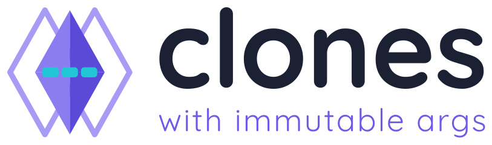

<p align="center">
  <picture>
    <source media="(prefers-color-scheme: dark)" srcset="assets/logo/cwia-wordmark-dark.svg">
    
  </picture>
</p>

# clones-with-immutable-args

Enables creating clone contracts with immutable arguments.

The immutable arguments are stored in the code region of the created proxy contract, and whenever the proxy is called, it reads the arguments into memory, and then appends them to the calldata of the delegate call to the implementation contract. The implementation contract can thus read the arguments straight from calldata.

By doing so, the gas cost of creating parametrizable clones is reduced. An [EIP-1167](https://eips.ethereum.org/EIPS/eip-1167) clone shares its implementation's code, so its immutables are fixed when the implementation is deployed and cannot differ per clone: the only way to parametrize one is storage, which means paying to write the parameters at creation and to load them on every call. Here the parameters live in the clone's own code instead, so there is no storage write at creation, and reads are calldata reads.

Note the comparison is against a _parametrized_ EIP-1167 clone, not against `immutable` variables on a regular contract. Solidity immutables are read from code and are already cheap, but they are the same for every clone of a given implementation, which is exactly what this library exists to work around.

In other word, if you know you are not gonna need parametrization and just want exact copies, then you can keep using EIP-1167, otherwise, clones-with-immutables is cheaper.

## Status

This library is stable and maintained on demand: it is not under active feature development, but issues and security reports are addressed. The API is settled and in production use, so there is no plan to break it.

Note that the immutable args are appended to the **calldata** of every delegatecall, so an implementation inheriting `Clone.sol` reads them with a plain `calldataload`. This costs a small overhead on every call and makes arg reads very cheap. Other minimal-proxy libraries make different tradeoffs, including storing args in the runtime bytecode and reading them back with `extcodecopy`.

## Usage

Clone factory contracts should use the [`ClonesWithImmutableArgs`](src/ClonesWithImmutableArgs.sol) library. `ClonesWithImmutableArgs.clone()` is the main function for creating clones.

Contracts intended to be cloned should inherit from [`Clone`](src/Clone.sol) to get access to the helper functions for reading immutable args.

To see an example usage of the library, check out [`ExampleClone`](src/ExampleClone.sol) and [`ExampleCloneFactory`](src/ExampleCloneFactory.sol).

## Installation

To install with [DappTools](https://github.com/dapphub/dapptools):

```
dapp install wighawag/clones-with-immutable-args
```

To install with [Foundry](https://github.com/gakonst/foundry):

```
forge install wighawag/clones-with-immutable-args
```

To install with [Hardhat](https://hardhat.org):

```
npm i -D clones-with-immutable-args
```

## Local development

This project uses [Foundry](https://github.com/gakonst/foundry) as the development framework.

### Dependencies

```
make update
```

### Compilation

```
make build
```

### Testing

```
make test
```
